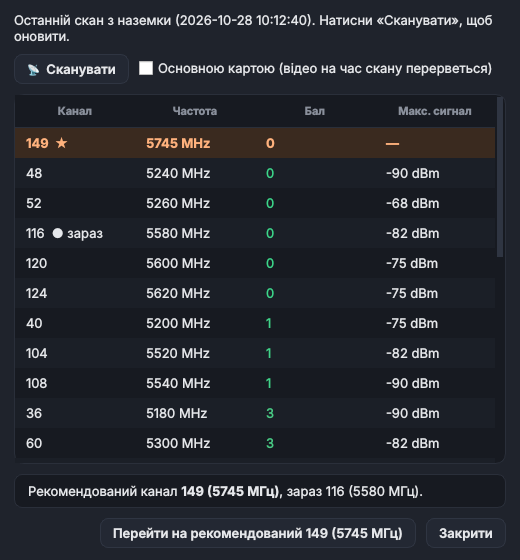

# SKYNET_FLIGHT — SkynetFlight, програма пілота для Windows для наземної станції SKYNET від DROZD TEAM

**SkynetFlight** — програма пілота для Windows. Вона підключається до наземної станції SKYNET і дає з одного вікна:

- відео з дрона з OSD і статистикою радіоканалу, запис відео у файл;
- керування дроном з пульта на ПК (RadioMaster TX16S та інші по USB): канали йдуть на наземку, а з неї в ефір;
- керування радіомодулем наземки: канал, потужність, BIND відео й пульта;
- скан радіоефіру і перехід на найчистіший канал;
- перемикання каналу відео перемикачем на пульті;
- попередження «UPDATING DRONE», коли наземка оновлює дрон;
- прошивку пульта EdgeTX і заливку на нього готової моделі;
- автооновлення самої програми.

Готові збірки — у розділі [Releases](../../releases). Нижче — інструкція користувача: для кожної вкладки й кожного блоку описано, для чого він і як працює.

---

## Зміст

1. [Встановлення](#встановлення)
2. [Швидкий старт](#швидкий-старт)
3. [Як влаштоване вікно](#як-влаштоване-вікно)
4. [Вкладка «Політ»](#вкладка-політ)
   - [Чіпи стану](#чіпи-стану)
   - [Канал](#канал)
   - [📡 Ефір](#-ефір)
   - [Потужність](#потужність)
   - [▶ Керування](#-керування)
   - [▶ Відео](#-відео)
   - [⏺ Запис](#-запис)
   - [BIND VIDEO](#bind-video)
   - [BIND RC](#bind-rc)
   - [Відеоекран](#відеоекран)
   - [Рядок стану](#рядок-стану)
5. [Вікно «Моніторинг ефіру»](#вікно-моніторинг-ефіру)
6. [Вкладка «Станції»](#вкладка-станції)
7. [Вкладка «Налаштування»](#вкладка-налаштування)
   - [Пульт і керування](#пульт-і-керування)
   - [Радіо наземки](#радіо-наземки)
   - [Запис відео](#запис-відео)
   - [Оновлення програми і брандмауер](#оновлення-програми-і-брандмауер)
   - [Прошивка пульта (EdgeTX)](#прошивка-пульта-edgetx)
   - [Скинути / Зберегти](#скинути--зберегти)
   - [Монітор каналів](#монітор-каналів)
   - [Канал відео з пульта (RC)](#канал-відео-з-пульта-rc)
8. [Вкладка «Логи»](#вкладка-логи)
9. [Пульт TX16S: 16 каналів по USB](#пульт-tx16s-16-каналів-по-usb)
10. [Прошивка пульта EdgeTX і заливка моделі](#прошивка-пульта-edgetx-і-заливка-моделі)
11. [Оновлення програми](#оновлення-програми)
12. [Брандмауер Windows](#брандмауер-windows)
13. [Файли програми](#файли-програми)
14. [Якщо щось не працює](#якщо-щось-не-працює)

---

## Встановлення

1. Відкрий [останній реліз](../../releases/latest) і завантаж `SkynetFlight-<версія>.zip`.
2. Розпакуй архів у звичайну папку, наприклад `C:\SkynetFlight`. Не розпаковуй у `Program Files`: програма зберігає поруч із собою налаштування й записи.
3. Один раз запусти `install.bat` **від імені адміністратора**. Він додає `SkynetFlight.exe` у винятки Windows Defender і відкриває потрібні порти у брандмауері.
4. Запускай `SkynetFlight.exe`. Під час першого запуску програма сама перевіряє брандмауер і, якщо відео заблоковане, пропонує його налаштувати (див. [Брандмауер Windows](#брандмауер-windows)).

Контрольна сума архіву лежить поруч у файлі `.zip.sha256`. Програма сама перевіряє її під час автооновлення.

---

## Швидкий старт

1. Підключи ПК до мережі станції: через NetBird або в одній локальній мережі з наземкою.
2. Вкладка **Станції**: дочекайся списку, клацни правою кнопкою по потрібній наземці і вибери «✅ Вибрати цю станцію».
3. Вкладка **Політ**: коли наземка відповість, у полях **Канал** і **Потужність** з'являться її поточні значення, а чіп **РАДІО** стане жовтим або зеленим.
4. Перед вильотом натисни **📡 Ефір** і перейди на рекомендований канал.
5. Натисни **▶ Відео**. Чіп **ВІДЕО** стане зеленим, з'явиться картинка з OSD.
6. Підключи пульт по USB у режимі джойстика і натисни **▶ Керування**. Чіп **ПУЛЬТ** стане зеленим, канали підуть на наземку.

---

## Як влаштоване вікно

Вікно має чотири вкладки:

| Вкладка | Для чого |
|---|---|
| **Політ** | усе, що потрібно в польоті: стан зв'язку, канал і потужність, увімкнення відео й керування, запис, BIND, відеоекран |
| **Станції** | список наземок і дронів, вибір станції, з якою працювати, службові дії зі станцією (віддалений RC, ключі, перезапуск) |
| **Налаштування** | пульт, рівні потужності, папка записів, оновлення програми, брандмауер, прошивка пульта, монітор каналів, канал відео з пульта |
| **Логи** | журнал роботи програми |

Внизу вікна — **рядок стану** з вибраною станцією і короткими повідомленнями про результат дій.

Загальні правила:

- **Відео й керування не вимикаються, коли переходиш між вкладками.** Вони зупиняються лише тоді, коли у вкладці «Станції» вибрано іншу наземку, або коли ти сам їх вимкнув.
- **Кнопки, які зараз не можуть спрацювати, сірі.** Наведи на сіру кнопку курсор: підказка скаже, чого бракує.
- Вибрана станція і всі налаштування запам'ятовуються: після перезапуску програма одразу працює з тією самою наземкою.

---

## Вкладка «Політ»

Угорі — панель керування, під нею — відеоекран.

### Чіпи стану

**Для чого.** Чотири кольорові мітки зліва показують з першого погляду, чи все готово до польоту.

**Як працює.** Програма постійно опитує наземку і пульт і перефарбовує чіпи:

| Чіп | Зелений | Жовтий | Червоний |
|---|---|---|---|
| **ВІДЕО** | кадри приходять на ПК | наземка шле відео, але в програмі воно ще не ввімкнене | відео немає |
| **РАДІО** | керування з цього ПК активне | наземка відповідає, радіомодуль доступний | наземка не відповідає |
| **ПУЛЬТ** | пульт шле канали на наземку | пульт підключений до ПК | пульта немає |
| **ДРОН** | є радіозв'язок наземки з дроном | — | зв'язку з дроном немає |

Наведи курсор на чіп, щоб побачити підказку.

### Канал

**Для чого.** Вибір каналу WFB (5 ГГц), на якому наземка й дрон передають відео і телеметрію. Поруч з номером каналу видно частоту: «116 · 5580 MHz».

**Як працює.**
- Коли вибираєш станцію, програма питає в наземки поточний канал і показує його. Поки відповіді немає, у полі стоїть **«—»**; після першої відповіді «—» зникає.
- Новий канал зі списку програма відправляє на наземку. Наземка разом із дроном переходить на нього **без зупинки відео**: на екрані лишається останній кадр, чіп ВІДЕО жовтий, потім картинка йде далі сама. Якщо за кілька секунд кадри не з'явились, програма сама перепідключає відео.
- Якщо на наземці ввімкнене [перемикання каналу з пульта](#канал-відео-з-пульта-rc), поле саме показує канал, вибраний перемикачем. Ручний вибір теж працює, але лише до наступного руху перемикача.

### 📡 Ефір

**Для чого.** Перевірити, які канали зайняті чужим трафіком, і перейти на найчистіший.

**Як працює.** Відкриває вікно [«Моніторинг ефіру»](#вікно-моніторинг-ефіру). Кнопка працює, коли вибрано станцію.

### Потужність

**Для чого.** Потужність передавача наземки: **Low**, **Med**, **High**. Більша потужність — більша дальність, але й більше нагрівання та завад.

**Як працює.** Вибраний рівень програма відправляє на наземку числом, яке задане для цього рівня у вкладці «Налаштування» → [«Радіо наземки»](#радіо-наземки). Підказка на полі показує, яке значення зараз стоїть на наземці. Як і в «Каналі», поки наземка не повідомила своє значення, стоїть «—».

### ▶ Керування

**Для чого.** Вмикає і вимикає передачу каналів пульта з ПК на наземку, тобто керування дроном з цього комп'ютера.

**Як працює.**
- Програма читає пульт (див. [«Пульт і керування»](#пульт-і-керування)) і з частотою, заданою в налаштуваннях (типово 100 разів на секунду), шле всі 16 каналів на наземку. Наземка передає їх у дрон.
- Кнопка доступна, коли наземка відповідає і на ній дозволене віддалене керування. Дозволяється це у вкладці «Станції»: правий клік → «💪 Активувати можливість віддаленого RC».
- Після увімкнення текст кнопки змінюється на **⏹ Керування**, а чіпи ПУЛЬТ і РАДІО стають зеленими.

### ▶ Відео

**Для чого.** Вмикає і вимикає відеопотік із наземки на цей ПК.

**Як працює.**
- Програма просить наземку слати відео, OSD і статистику на IP цього ПК і показує картинку на відеоекрані.
- Кнопка доступна, коли наземка повідомляє, що відеосигнал є (раз на 2 секунди програма це перевіряє). Інакше кнопка сіра з підказкою «Немає джерела відеосигналу».
- Після увімкнення текст змінюється на **⏹ Відео**.

### ⏺ Запис

**Для чого.** Записує відео з дрона у файл.

**Як працює.** Пише файл `.mp4` з назвою за датою й часом, наприклад `2026-10-28_14-05-31.mp4`, у папку з налаштувань (типово `rec` поруч із програмою). Натисни ще раз (**⏹ Запис**), щоб зупинити запис. Кнопка доступна лише тоді, коли відео ввімкнене.

### BIND VIDEO

**Для чого.** Прив'язує відеоканал дрона до цієї наземки: після цього дрон і наземка мають спільний ключ і бачать одне одного.

**Як працює.** Програма відправляє наземці команду BIND і чекає результату до 35 секунд. Дрон має бути ввімкнений і в режимі прив'язки. Якщо дрон уже на зв'язку, програма спершу попросить підтвердження, бо прив'язка перерве поточне з'єднання. Якщо прошивка дрона застаріла, наземка під час BIND оновить її: на екрані з'явиться [UPDATING DRONE](#відеоекран).

### BIND RC

**Для чого.** Прив'язує RC-приймач дрона, щоб він приймав канали керування від наземки.

**Як працює.** Відправляє наземці команду прив'язки пульта. Кнопка доступна, коли ввімкнене «Керування».

### Відеоекран

**Для чого.** Картинка з дрона та все, що про неї треба знати.

**Як працює.**
- **OSD** — поверх картинки малюються дані польотного контролера (батарея, режим, висота тощо), як в окулярах.
- **Смуга статистики внизу** — якість радіоканалу: `RSSI` (рівень сигналу), `SNR` (сигнал/шум), `LOSS` (втрачені пакети), `FEC` (відновлені пакети), `BR` (бітрейт), `ANT` (активна антена), канал і потужність.
- **⚠ ADAPTERS** у правому верхньому куті — якщо на наземці якийсь радіоадаптер не в робочому режимі або зник. Поруч назва адаптера і проблема.
- **NO SIGNAL** — відео немає: воно вимкнене, наземка не шле кадри або їх блокує брандмауер.
- **UPDATING DRONE — НЕ ВИМИКАЙ ЖИВЛЕННЯ** (жовтим, зі зворотним відліком) — наземка зараз оновлює прошивку дрона. Це буває під час BIND, якщо на дроні стара прошивка. Напис той самий, що на екрані наземки; якщо відео йде, він з'являється поверх картинки. **Не вимикай дрон, поки напис не зникне.** Так само під час прив'язки показується **BINDING** з відліком.
- **Подвійний клік** по відео відкриває його на весь екран. Вихід: подвійний клік ще раз або клавіша **Esc**.

> Напис UPDATING DRONE з'являється лише з наземками, що вміють повідомляти свій стан (команда `GETSTATUS`). Зі старішими наземками програма працює як раніше, просто без цього напису.

### Рядок стану

**Для чого.** Показує, з якою станцією ти працюєш, і результат останньої дії.

**Як працює.** Постійно видно «Вибрана: <серійний номер> | ID: <ідентифікатор>». Після кожної команди на кілька секунд з'являється результат: «✅ Потужність змінено на …», «❌ Команда не виконана», «⏳ Таймаут: немає відповіді» тощо. Тут же програма пише «⬆ Доступна нова версія …» і «⏳ Оновлення дрона — не вимикай живлення».

---

## Вікно «Моніторинг ефіру»

**Для чого.** Перед вильотом побачити, які канали 5 ГГц зайняті чужим трафіком (інші дрони, Wi-Fi, РЕБ), і перейти на найчистіший.

**Як працює.** Скан робить сама наземка: її радіоадаптер по черзі слухає кожен канал і рахує чужі пакети. Програма лише запускає скан, показує результат і перемикає канал.

1. Відкрий вікно кнопкою **📡 Ефір** на вкладці «Політ». Якщо наземка вже робила скан, одразу видно його результат і час.
2. Натисни **📡 Сканувати**. Скан триває близько 25 секунд.
   - Зазвичай наземка сканує вільним (запасним) адаптером, і відео не переривається.
   - Якщо вільного адаптера немає, програма про це скаже. Тоді можна поставити галочку **«Основною картою»**: скан зробить основний адаптер, але на час скану відео й лінк переривається.
3. Таблиця відсортована від найчистішого каналу:

   | Стовпець | Що означає |
   |---|---|
   | **Канал** | номер каналу; **★** — рекомендований наземкою, **● зараз** — поточний |
   | **Частота** | частота каналу в МГц |
   | **Бал** | скільки чужого трафіку на каналі. **Менший бал — чистіший канал.** Колір від зеленого (чисто) до червоного (шумно) |
   | **Макс. сигнал** | найсильніший чужий сигнал на каналі, dBm. «—» — чужих сигналів не чути |

4. Під таблицею написано рекомендований канал і поточний. Натисни **Перейти на рекомендований** або вибери інший рядок і натисни «Перейти на канал …». Канал перемикається як звичайно: синхронно на наземці й дроні, без зупинки відео.

Якщо внизу написано «ти вже на ньому», поточний канал і так найкращий — можна летіти.

---

## Вкладка «Станції»

**Для чого.** Знайти наземку, вибрати, з якою працювати, і зробити зі станцією службові дії.

### Таблиця станцій

**Як працює.** Програма збирає станції з двох джерел: із мережі NetBird і з локальної мережі (шукає наземки в тій самій мережі, що ПК). Наземки називаються `GS…`, дрони — `DR…`.

| Стовпець | Що означає |
|---|---|
| **Статус** | 🟢 Online — станція на зв'язку, 🔴 Offline — ні |
| **Серійний номер станції** | назва станції |
| **IP-адреса** | адреса, за якою програма звертається до станції |
| **Ідентифікатор** | ID запису в NetBird (у локальних станцій порожній) |

- **Синюватий фон** — станція знайдена в локальній мережі, **звичайний фон** — станція з NetBird. Локальне з'єднання швидше, тож якщо станція є і там, і там, вибирай локальну.
- Якщо в NetBird є кілька записів з однаковою назвою (наприклад, після перевстановлення станції), програма лишає найсвіжіший, а старі копії видаляє з сервера NetBird. Запис, який зараз на зв'язку, не видаляється ніколи.
- Вибір іншої станції зупиняє відео й керування з попередньою. Вибір тієї самої станції ще раз нічого не перериває.

### Кнопка «⟳ Оновити список»

Перечитує список станцій з NetBird і локальної мережі.

### Меню правого кліку

Клацни правою кнопкою по станції:

| Пункт | Для чого і як працює |
|---|---|
| ✅ **Вибрати цю станцію** | робить станцію поточною: програма питає в неї канал і потужність, і з нею працюють усі кнопки вкладки «Політ» |
| 💪 **Активувати можливість віддаленого RC** | дозволяє наземці приймати канали пульта з ПК. Без цього кнопка «Керування» сіра |
| ✋ **Відключити можливість віддаленого RC** | забороняє віддалене керування; наземка знову слухає лише свій пульт |
| 📋 **Копіювати IP** | копіює IP-адресу станції в буфер обміну (наприклад, щоб відкрити вебінтерфейс наземки) |
| 💔 **Перезапустити сервіси** | перезапускає сервіси радіоканалу на наземці. Допомагає, коли наземка відповідає, але відео чи керування «завислі». Займає кілька секунд, відео на цей час переривається |
| ❌ **Згенерувати новий BIND ключ (скинути старий)** | наземка створює нову пару ключів шифрування. Старий дрон після цього її не бачить: його треба прив'язати знову через BIND VIDEO. Програма просить підтвердження |
| 💾 **Скачати ключ у файл** | зберігає ключ прив'язки наземки у файл (папка `keys`) |
| 📤 **Завантажити ключ з файлу на наземку** | записує збережений ключ на наземку. Так дві наземки можуть працювати з одним дроном: ключ скачують з однієї й заливають на другу. Програма просить підтвердження, після запису наземка перезапускає прийом |
| 🔄 **Оновити список** | те саме, що кнопка «⟳ Оновити список» |
| 📡 **Пересканувати локальну мережу** | шукає наземки в локальній мережі заново (наприклад, якщо наземку щойно ввімкнули) |

> «Скачати ключ» і «Завантажити ключ» потребують наземки з командами `GETKEY` / `SETKEY`. Стара наземка відповідає `UNKNOWN`.

---

## Вкладка «Налаштування»

Ліворуч — налаштування програми, праворуч — монітор каналів пульта і налаштування каналу відео з пульта (вони зберігаються на наземці).

### Пульт і керування

**Для чого.** Звідки програма читає пульт і як часто шле канали на наземку.

**Як працює.**
- **Джерело пульта**
  - *Авто: HID (TX16S), інакше pygame* — спершу шукає пульт TX16S / EdgeTX напряму через HID (усі 16 каналів); якщо його немає, бере будь-який джойстик Windows.
  - *Тільки HID (TX16S, 16 каналів)* — лише пульти EdgeTX у режимі USB Joystick.
  - *Тільки pygame (будь-який джойстик, до 8 осей)* — будь-який джойстик чи геймпад, але Windows віддає не більше 8 осей.
- **Частота відправки** — скільки разів на секунду канали надсилаються на наземку, 10–250 Гц, типово 100 Гц. Більше — менша затримка, але більше трафіку; через слабкий інтернет краще 50 Гц.

### Радіо наземки

**Для чого.** Що саме означають рівні Low / Med / High у полі «Потужність» на вкладці «Політ».

**Як працює.** Три числа — значення потужності, які програма відправляє наземці для кожного рівня. Типово **Low 1900**, **Med 2700**, **High 3174**. Міняй їх, лише якщо знаєш можливості свого радіоадаптера.

### Запис відео

**Для чого.** Куди кнопка «⏺ Запис» зберігає файли.

**Як працює.** **Папка записів** — шлях до папки. Якщо поле порожнє, записи йдуть у папку `rec` поруч із програмою (сірий текст у полі показує цей шлях). **Обрати…** відкриває вибір папки.

### Оновлення програми і брандмауер

**Для чого.** Оновити SkynetFlight до нової версії і перевірити, чи брандмауер Windows не блокує відео.

**Як працює.**
- **Версія** — поточна версія програми; поруч стан: «Встановлено останню версію» або «Доступна версія …».
- **Перевірити** — питає в GitHub, чи є новий реліз. Під час запуску програма робить це сама, тихо.
- **Оновити до …** — з'являється, коли є нова версія: завантажує, перевіряє і встановлює її (докладно в [Оновлення програми](#оновлення-програми)).
- **Брандмауер** — стан: «✅ налаштовано» або перелік проблем (закритий порт, правило «Блокувати», загальнодоступна мережа NetBird).
- **Налаштувати брандмауер** — виправляє всі ці проблеми одним натиском (докладно в [Брандмауер Windows](#брандмауер-windows)).

### Прошивка пульта (EdgeTX)

**Для чого.** Прошити пульт керування офіційною прошивкою EdgeTX і залити на нього готову модель SKYNET remote, налаштовану під SkynetFlight.

**Як працює.**
- **Пульт** — модель твого пульта (TX16S, TX12, Boxer…).
- **EdgeTX** — версія прошивки зі списку офіційних релізів EdgeTX; перша в списку — остання. **⟳** перечитує список з GitHub.
- **Прошити** — прошиває пульт по USB у режимі DFU і перевіряє запис.
- **Модель** — яку модель залити: готовий файл, нова модель «SKYNET remote» під вибраний пульт або «Обрати файл моделі…» (свій `.yml`).
- **Залити модель** — копіює модель на SD-карту пульта, підключеного як USB-диск.
- **?** — покрокова інструкція саме для вибраного пульта.
- Під кнопками — рядок стану прошивки: хід, помилки, «✅ Готово».

Докладно — у розділі [Прошивка пульта EdgeTX і заливка моделі](#прошивка-пульта-edgetx-і-заливка-моделі).

### Скинути / Зберегти

**Для чого.** Застосувати налаштування лівої колонки.

**Як працює.** **Зберегти** застосовує налаштування одразу і записує їх у `config.ini`. **Скинути** підставляє у форму типові значення; щоб застосувати їх, натисни «Зберегти». Ці кнопки не стосуються блоку «Канал відео з пульта (RC)»: він зберігається на наземці своєю кнопкою.

### Монітор каналів

**Для чого.** Перевірити пульт перед польотом: чи всі стіки й перемикачі рухаються і на який канал вони потрапляють.

**Як працює.** Показує в реальному часі всі 16 каналів (1000–2000 мкс). Кожен канал має свій колір, як у Betaflight Configurator, тож легко побачити, який бігунок рухається.
- Коли «Керування» ввімкнене, заголовок — «Монітор каналів (що йде на наземку)»: видно саме те, що відправляється.
- Коли вимкнене — «Монітор каналів пульта»: програма читає пульт лише для перегляду, на наземку нічого не йде.
- «— пульт не читається» в заголовку — програма не бачить пульт: перевір кабель, режим USB Joystick і «Джерело пульта».

### Канал відео з пульта (RC)

**Для чого.** Перемикати канал відео прямо з пульта: перемикачем або крутилкою на одному з каналів CRSF. Те саме, що «Системні» → «Канал відео з пульта (RC)» у вебінтерфейсі наземки.

**Як працює.** Рішення приймає борт: він бачить положення перемикача, за пів секунди попереджає наземку, і обидва перемикаються одночасно. Канал змінюється приблизно через 1,5 с після повороту перемикача, бо нове положення має протриматися 1 с. Наземка сама передає налаштування на борт, під час BIND і щойно почує борт. Програма лише читає й записує налаштування на наземці.

**Стан угорі блоку** (оновлюється раз на 1,5 с):

| Рядок | Що означає |
|---|---|
| **Стан** | борт на зв'язку (зелений) / борт не чути (червоний) / пошук борта… / перемикання… |
| **Канал наземки** | поточний канал наземки з частотою |
| **Борт** | поточний канал борта; підказка показує налаштування, якими користується борт |
| **Налаштування борта** | «збігаються» або «передаються на борт…» |

**Налаштування:**

1. Постав галочку **«Перемикати канал відео перемикачем на пульті»**.
2. Вибери **Канал CRSF перемикача**, 1–16. Рахунок як на пульті: 1–4 — стіки.
3. Відміть **канали відео**, між якими перемикатися (поруч з номером — частота). Хід перемикача 1000–2000 мкс ділиться на стільки рівних частин, скільки каналів відмічено, по порядку частоти: мінімум перемикача — найнижча частота. Під списком видно порядок, наприклад «116 (5580) → 149 (5745) → …». Ці ж канали наземка перебирає, щоб знайти борт, якщо втратила його (~1 с без зв'язку).
4. Натисни **«Зберегти на наземці»**. Програма покаже `OK` або причину, чому наземка не прийняла налаштування.
   - Без жодного відміченого каналу зберегти не можна.
   - Під час BIND чи оновлення дрона зберегти не можна: збережи, коли закінчиться.
5. **⟳** повертає у форму те, що зараз збережено на наземці (якщо ти щось змінив, але передумав).

Коли режим увімкнений, поле «Канал» на вкладці «Політ» саме показує канал, вибраний перемикачем.

> Функція потребує наземки з командами `GETRCCHAN` / `SETRCCHAN` і борта з `rc_chan`. Якщо наземка старіша, блок пише, що наземку треба оновити.

---

## Вкладка «Логи»

**Для чого.** Розібратися, що пішло не так.

**Як працює.** Журнал роботи програми (останні 1000 рядків): які команди відправлено на наземку і що вона відповіла, підключення відео й пульта, оновлення, помилки. Текст можна виділити і скопіювати (Ctrl+A, Ctrl+C), щоб надіслати розробнику. Ключі прив'язки в журнал не пишуться.

---

## Пульт TX16S: 16 каналів по USB

Windows через DirectInput бачить лише 8 осей джойстика, тому SkynetFlight читає TX16S напряму через HID і отримує всі 16 каналів.

Налаштування в пульті (EdgeTX 2.8 і новіше):

1. Підключи пульт кабелем і вибери режим **USB Joystick (HID)**.
2. **Model → Setup → USB Joystick → Mode: Advanced**.
3. Для CH1–CH16 вибери тип **Axis** (або **Sim**). Кожному каналу — своя вісь, без повторів.
4. У SkynetFlight: «Налаштування» → «Джерело пульта» → **Авто** або **Тільки HID**.
5. Перевір рух стіків і перемикачів на «Моніторі каналів».

Відповідність каналів і осей USB-джойстика (так їх читає SkynetFlight):

| Канали | Осі в EdgeTX |
|---|---|
| CH1–CH9 | X, Y, Z, Rx, Ry, Rz, Slider, Dial, Wheel |
| CH10–CH16 | Aileron, Elevator, Rudder, Throttle, Accelerator, Brake, Steering |

Модель **SKYNET remote**, яку заливає програма, уже налаштована саме так.

---

## Прошивка пульта EdgeTX і заливка моделі

З версії 1.4.0 SkynetFlight сама прошиває пульт керування: версія EdgeTX береться з [офіційного репозиторію EdgeTX](https://github.com/EdgeTX/edgetx/releases), прошивка пишеться по USB у режимі DFU, після запису програма читає її назад і перевіряє.

| Пульт | Версії EdgeTX |
|---|---|
| RadioMaster TX16S / TX16S MK2 | усі |
| RadioMaster TX12 (MK1) | до 2.11.x (новіші EdgeTX цей пульт не підтримують) |
| RadioMaster TX12 MK2 | усі |
| RadioMaster Boxer | усі |

Список пультів поповнюватиметься.

### Один раз на цьому ПК: драйвер

Windows сама не дає програмам доступу до пульта в режимі DFU. Потрібен драйвер **WinUSB** для пристрою «STM32 BOOTLOADER»:

- найпростіше — [ImpulseRC Driver Fixer](https://github.com/ImpulseRC/ImpulseRC_Driver_Fixer/releases): запусти його, підключи вимкнений пульт по USB, він сам поставить драйвер;
- або [Zadig](https://zadig.akeo.ie/): Options → List All Devices → «STM32 BOOTLOADER» → WinUSB → Install Driver.

### Прошивка EdgeTX: що за чим робити

1. **Збережи моделі.** Увімкни пульт, підключи USB, на пульті вибери **USB Storage (SD)** і скопіюй папки `MODELS` і `RADIO` з SD-карти собі на ПК.
2. У SkynetFlight: **Налаштування → Прошивка пульта**. Вибери **пульт** і **версію EdgeTX** (⟳ оновлює список; перша в списку — остання).
3. **Вимкни пульт.**
4. Натисни **Прошити** і підтверди.
5. Підключи USB-кабель до **вимкненого** пульта, у роз'єм на верхній панелі (у TX16S — не той, що в батарейному відсіку). Пульт не вмикається: це режим DFU. Програма чекає пульт до 90 секунд.
6. Дочекайся кінця: **стирання → запис → перевірка**, 1–3 хвилини. **Не від'єднуй кабель і не закривай програму** (вона й не дасть закритися під час прошивки).
7. Після «Готово» від'єднай кабель і увімкни пульт.
8. Якщо пульт попереджає про версію SD-карти — онови вміст SD-карти SD-пакетом EdgeTX тієї самої версії.

Перший раз програма завантажує архів EdgeTX (кілька десятків МБ) і далі бере його з кешу.

### Модель SKYNET remote

1. **Увімкни** пульт і підключи USB. На пульті вибери **USB Storage (SD)** — у Windows з'явиться диск з папками `MODELS` і `RADIO`.
2. У блоці «Прошивка пульта» вибери **модель** і натисни **Залити модель**. Можна вибрати й свій файл: «Обрати файл моделі…» (`*.yml` з папки `MODELS` іншого пульта).
   Якщо готового файлу моделі в програмі немає, вона **створює нову модель «SKYNET remote»** під вибраний пульт:
   - CH1–CH4 — стики (Ail, Ele, Thr, Rud);
   - далі перемикачі SA, SB, … і потенціометри пульта;
   - USB Joystick у режимі Advanced: 16 окремих осей (саме так їх читає SkynetFlight);
   - радіомодулі вимкнені — пульт працює лише як USB-джойстик.

   На TX12 і Boxer ім'я моделі обмежене 10 символами, тому там вона називається «SKYNET rem».
3. Якщо на пульті вже є модель з таким самим ім'ям, програма її замінить, а стару копію збереже в `MODELS\skynetflight_backup`. Інакше модель додається як новий `modelN.yml`, інші моделі не чіпаються.
4. Безпечно витягни диск у Windows, від'єднай кабель і вибери модель на пульті.
5. Для роботи з SkynetFlight підключи USB ще раз і вибери **USB Joystick (HID)**.

### Якщо прошивка не вдалася

Пульт так не зіпсуєш: режим DFU вбудований у процесор. Вимкни пульт, від'єднай батарею на 10 секунд, підключи USB у вимкненому стані й проший ще раз. Якщо прошив не той пульт — вибери правильний і проший знову.

| Повідомлення | Що робити |
|---|---|
| «Пульт у режимі DFU не знайдено» | пульт має бути вимкнений; інший кабель (деякі лише заряджають); інший роз'єм |
| «Потрібен драйвер WinUSB» | постав драйвер (див. вище) |
| «У EdgeTX … немає прошивки для …» | ця версія не підтримує пульт — вибери іншу |
| «Пульт як диск не знайдено» | на пульті треба вибрати USB Storage (SD), а не Joystick |

---

## Оновлення програми

**Налаштування → Оновлення програми → «Перевірити» → «Оновити до …».**

Програма сама:
1. завантажує новий реліз із цього репозиторію;
2. перевіряє контрольну суму (пошкоджений архів не встановлюється);
3. закривається, замінює файли і запускається знову.

Твої налаштування (`config.ini`), список локальних станцій, записи (`rec`) і ключі (`keys`) при оновленні зберігаються.

Під час запуску програма тихо перевіряє, чи є нова версія, і показує це в налаштуваннях. Якщо зараз активні керування або відео, програма перед оновленням попросить підтвердження.

Оновити вручну теж можна: завантаж новий zip і розпакуй поверх старої папки.

> До версії 1.4.0 програма звалася **SkynetFly**. Реліз 1.4.0 ще містить архів під старою назвою, тому SkynetFly 1.3.x оновлюється до нього автоматично. Наступні релізи виходять лише як **SkynetFlight**: якщо в тебе ще 1.3.x, а автооновлення не знаходить нову версію, завантаж zip вручну і розпакуй поверх старої папки. Ярлики на `SkynetFly.exe` заміни на `SkynetFlight.exe`.

---

## Брандмауер Windows

Щоб відео, OSD і статистика доходили з наземки до ПК, у брандмауері Windows мають бути відкриті вхідні порти, а програму ніщо не повинно блокувати. Найчастіша причина «кнопка Відео зелена, а на екрані NO SIGNAL» — правило **«Блокувати»** для програми, яке Windows створює, якщо на запит «Дозволити доступ?» колись натиснули «Скасувати». Таке правило сильніше за будь-який дозвіл.

Під час запуску програма перевіряє брандмауер і, якщо є проблеми, показує, що саме не так, і пропонує налаштувати. Windows попросить права адміністратора. Програма:

- прибирає вхідні правила «Блокувати» для себе;
- відкриває вхідні порти UDP 5601 (відео), 17654 (OSD), 17655 (статистика) і дозволяє саму програму для всіх типів мереж;
- робить мережу NetBird (`wt0`) **приватною**, а не загальнодоступною.

Якщо відмовитись, програма не питатиме знову до наступної версії. Налаштувати можна будь-коли: **Налаштування → Оновлення програми → Налаштувати брандмауер**. Журнал налаштування лежить у `%TEMP%\skynetflight_firewall.log`.

---

## Файли програми

| Файл / папка | Що там |
|---|---|
| `SkynetFlight.exe` | програма |
| `config.ini` | вибрана станція і налаштування |
| `local_stations.json` | станції з локальної мережі |
| `rec\` | записи відео (якщо не вибрано іншу папку) |
| `keys\` | збережені ключі прив'язки |
| `radio_models\` | моделі EdgeTX для заливки на пульт |
| `install.bat` | одноразове налаштування Defender і брандмауера |

---

## Якщо щось не працює

| Проблема | Що перевірити |
|---|---|
| Список станцій порожній | чи працює NetBird / чи ПК у тій самій мережі, що наземка; натисни «Оновити список» |
| Чіп РАДІО червоний | наземка вимкнена або недоступна по мережі |
| «Керування» сіре | на станції не дозволений віддалений RC: правий клік → «Активувати можливість віддаленого RC» |
| Чіп ДРОН червоний | дрон вимкнений, не прив'язаний (BIND VIDEO) або на іншому каналі |
| На відео «⚠ ADAPTERS» | радіоадаптер наземки не в робочому режимі або відпав: «Перезапустити сервіси», інакше перевір наземку |
| «Відео» сіре | наземка зараз не шле відео: перевір дрон і відеоканал |
| Відео не з'являється, хоча на екрані наземки воно є | **Налаштування → Налаштувати брандмауер** (або `install.bat` від адміністратора) |
| Блок «Канал відео з пульта» пише, що наземку треба оновити | на наземці ще немає цієї функції — онови наземку |
| «Налаштування борта: передаються на борт…» довго не змінюється | борт не чує наземку; він працюватиме з останньою копією налаштувань, а нові отримає при BIND |
| «Скачати ключ» / «Завантажити ключ» пише `UNKNOWN` | наземка ще не підтримує GETKEY / SETKEY — потрібне оновлення наземки |
| Таблиця в «Ефірі» порожня | натисни «Сканувати»; якщо наземка пише, що немає вільного адаптера, — постав галочку «Основною картою» |
| Пульт не видно / чіп ПУЛЬТ червоний | кабель, режим USB Joystick у пульті, «Джерело пульта» в налаштуваннях |
| Працюють лише 8 каналів | у налаштуваннях вибрано pygame — переключи на «Авто» або «Тільки HID», у пульті вибери Mode: Advanced |
| Оновлення не встановлюється | доступ до github.com; деталі у вкладці «Логи» |

Вхідні порти, які відкриває `install.bat` (на випадок ручного налаштування брандмауера): UDP 5601 (відео), 17654 (OSD), 17655 (статистика), 9001 (пульт), 51820 (NetBird) і TCP 8103 (статистика WFB).
