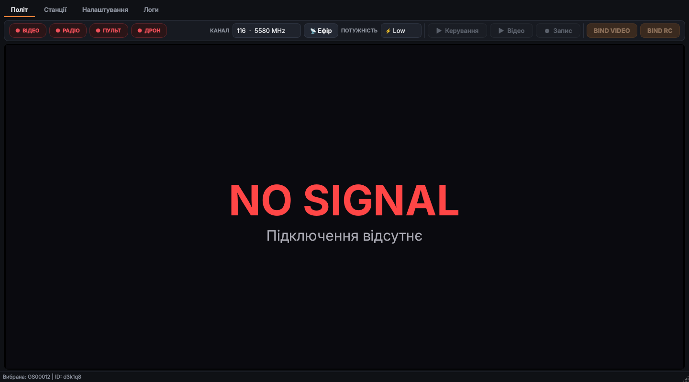
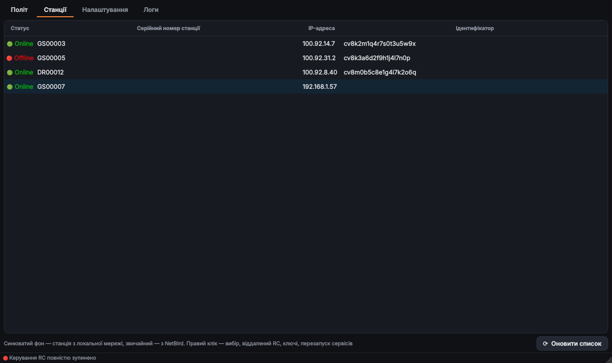
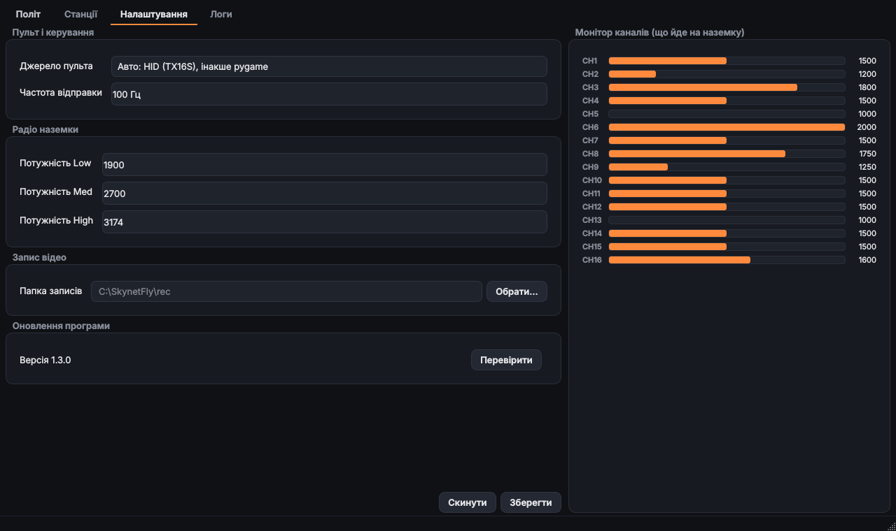

# SKYNET_FLIGHT — SkynetFlight, програма пілота для Windows для наземної станції SKYNET від DROZD TEAM

**SkynetFlight** — програма пілота для Windows. Вона підключається до наземної станції SKYNET, показує відео з дрона з OSD, передає на наземку канали з пульта (наприклад, RadioMaster TX16S по USB) і керує радіомодулем станції: канал, потужність, BIND.

Готові збірки — у розділі [Releases](../../releases). Нижче інструкція користувача.

---

## Зміст

1. [Встановлення](#встановлення)
2. [Швидкий старт](#швидкий-старт)
3. [Вкладка «Політ»](#вкладка-політ)
4. [Вкладка «Станції»](#вкладка-станції)
5. [Вкладка «Налаштування»](#вкладка-налаштування)
6. [Вкладка «Логи»](#вкладка-логи)
7. [Пульт TX16S: 16 каналів по USB](#пульт-tx16s-16-каналів-по-usb)
8. [Прошивка пульта EdgeTX і заливка моделі](#прошивка-пульта-edgetx-і-заливка-моделі)
9. [Оновлення програми](#оновлення-програми)
10. [Файли програми](#файли-програми)
11. [Якщо щось не працює](#якщо-щось-не-працює)

---

## Встановлення

1. Відкрий [останній реліз](../../releases/latest) і завантаж `SkynetFlight-<версія>.zip`.
2. Розпакуй архів у звичайну папку, наприклад `C:\SkynetFlight`. Не розпаковуй у `Program Files`: програма зберігає поруч із собою налаштування й записи.
3. Один раз запусти `install.bat` **від імені адміністратора**. Він додає `SkynetFlight.exe` у винятки Windows Defender і відкриває потрібні порти у брандмауері.
4. Запускай `SkynetFlight.exe`.

Контрольна сума архіву лежить поруч у файлі `.zip.sha256`. Програма сама перевіряє її під час автооновлення.

---

## Швидкий старт

1. Підключи ПК до мережі станції: через NetBird або в одній локальній мережі з наземкою.
2. Вкладка **Станції**: дочекайся списку, клацни правою кнопкою по потрібній наземці і вибери «✅ Вибрати цю станцію».
3. Вкладка **Політ**: коли наземка відповість, у полях **Канал** і **Потужність** з'являться її поточні значення, а чіп **РАДІО** стане жовтим або зеленим.
4. Натисни **▶ Відео**. Чіп **ВІДЕО** стане зеленим, з'явиться картинка з OSD.
5. Підключи пульт по USB у режимі джойстика і натисни **▶ Керування**. Чіп **ПУЛЬТ** стане зеленим, канали підуть на наземку.

> Кнопки, які зараз не можуть спрацювати, сірі. Наприклад, «Відео» недоступне, поки наземка не шле відеосигнал, а «Запис» — поки відео не ввімкнене.

---

## Вкладка «Політ»

### Чіпи стану

| Чіп | Зелений | Жовтий | Червоний / сірий |
|---|---|---|---|
| **ВІДЕО** | кадри приходять | наземка шле відео, але воно ще не ввімкнене в програмі | відео немає |
| **РАДІО** | керування на наземці активне | радіомодуль доступний | наземка не відповідає |
| **ПУЛЬТ** | пульт шле канали | пульт підключений до ПК | пульта немає |
| **ДРОН** | є радіозв'язок із дроном | — | зв'язку з дроном немає |

Наведи курсор на чіп, щоб побачити підказку.

### Канал і потужність

- **Канал** — канал WFB у діапазоні 5 ГГц. Під час зміни каналу відео ненадовго зупиняється, наземка перемикається, і відео вмикається знову.
- **Потужність** — три рівні передавача наземки: **Low**, **Med**, **High**. Числові значення рівнів задаються на вкладці «Налаштування».
- Поки наземка не повідомила свої параметри, в обох полях стоїть **«—»**. Після першої відповіді «—» зникає, і вибрати його вже не можна. Після вибору іншої станції «—» з'являється знову, доки не прийдуть її параметри.

### Кнопки

| Кнопка | Що робить | Коли доступна |
|---|---|---|
| **▶ Керування** | вмикає / вимикає передачу каналів пульта на наземку | наземка відповідає і на ній дозволене віддалене керування (RC) |
| **▶ Відео** | вмикає / вимикає відеопотік із наземки на цей ПК | наземка шле відеосигнал |
| **⏺ Запис** | записує відео у файл `.mp4` | відео ввімкнене |
| **BIND VIDEO** | запускає прив'язку відеоканалу дрона до наземки (до 35 с) | станція підключена |
| **BIND RC** | запускає прив'язку RC-приймача дрона | керування підключене |

Якщо дрон уже на зв'язку, BIND спершу попросить підтвердження, бо прив'язка перерве поточне з'єднання.

### Відео

- Поверх картинки виводиться OSD польотного контролера і смуга зі статистикою радіоканалу.
- **Подвійний клік** по відео відкриває його на весь екран. Вихід: подвійний клік ще раз або клавіша **Esc**.
- Коли сигналу немає, на екрані логотип і напис **NO SIGNAL**.

---

## Вкладка «Станції»

Тут список доступних наземок (`GS…`) і дронів (`DR…`) зі статусом Online / Offline.

- **Синюватий фон** — станція знайдена в локальній мережі. **Звичайний фон** — станція з NetBird.
- Якщо в NetBird є кілька записів з однаковою назвою (наприклад, після перевстановлення станції), програма лишає найсвіжіший, а старі копії видаляє з сервера NetBird. Запис, який зараз на зв'язку, не видаляється ніколи.
- Вибрана станція запам'ятовується: при наступному запуску програма одразу працює з нею.
- **⟳ Оновити список** перечитує список станцій.

### Меню правого кліку

| Пункт | Що робить |
|---|---|
| ✅ Вибрати цю станцію | робить станцію поточною |
| 💪 Активувати можливість віддаленого RC | дозволяє наземці приймати канали пульта з цього ПК |
| ✋ Відключити можливість віддаленого RC | забороняє віддалене керування |
| 📋 Копіювати IP | копіює IP-адресу станції |
| 💔 Перезапустити сервіси | перезапускає сервіси на наземці |
| ❌ Згенерувати новий BIND ключ | скидає старий ключ прив'язки і створює новий (після цього дрон треба прив'язати знову) |
| 💾 Скачати ключ у файл | зберігає ключ прив'язки станції у файл |
| 📤 Завантажити ключ з файлу на наземку | записує збережений ключ на наземку (наприклад, щоб дві станції працювали з одним дроном) |
| 🔄 Оновити список | перечитує список |
| 📡 Пересканувати локальну мережу | шукає станції в локальній мережі заново |

Дії, що змінюють ключі, спершу просять підтвердження.

---

## Вкладка «Налаштування»

### Пульт і керування

- **Джерело пульта**
  - *Авто* — спершу пульт TX16S напряму (HID, усі 16 каналів), якщо його немає — будь-який джойстик через pygame.
  - *Тільки HID* — лише TX16S / EdgeTX, 16 каналів.
  - *Тільки pygame* — будь-який джойстик Windows, до 8 осей.
- **Частота відправки** — скільки разів на секунду канали надсилаються на наземку (типово 100 Гц).

### Радіо наземки

Значення трьох рівнів потужності для кнопки «Потужність» на вкладці «Політ». Типово **Low 1900**, **Med 2700**, **High 3174**.

### Запис відео

**Папка записів** — куди зберігаються файли `.mp4`. Якщо поле порожнє, записи йдуть у папку `rec` поруч із програмою. Кнопка **Обрати…** відкриває вибір папки.

### Оновлення програми

Поточна версія і кнопка **Перевірити** / **Оновити**. Докладніше в розділі [Оновлення програми](#оновлення-програми).

### Прошивка пульта (EdgeTX)

Прошивка пульта керування офіційним EdgeTX і заливка на пульт моделі SKYNET remote. Докладно — у розділі [Прошивка пульта EdgeTX і заливка моделі](#прошивка-пульта-edgetx-і-заливка-моделі). Кнопка **?** показує покрокову інструкцію для вибраного пульта.

### Монітор каналів

Праворуч у реальному часі видно всі 16 каналів (1000–2000 мкс), які зараз ідуть на наземку. Зручно для перевірки пульта перед польотом.

**Зберегти** застосовує й запам'ятовує налаштування. **Скинути** підставляє у форму типові значення (щоб застосувати їх, натисни «Зберегти»).

---

## Вкладка «Логи»

Журнал роботи програми: відправлені команди, відповіді наземки, підключення відео і пульта, помилки. Якщо щось пішло не так, скопіюй звідси текст і надішли розробнику.

---

## Пульт TX16S: 16 каналів по USB

Windows через DirectInput бачить лише 8 осей джойстика, тому SkynetFlight читає TX16S напряму через HID і отримує всі 16 каналів.

Налаштування в пульті (EdgeTX 2.8 і новіше):

1. Підключи пульт кабелем і вибери режим **USB Joystick (HID)**.
2. **Model → Setup → USB Joystick → Mode: Advanced**.
3. Для CH1–CH16 вибери тип **Axis** (або **Sim**). Кожному каналу — своя вісь, без повторів.
4. У SkynetFlight: «Налаштування» → «Джерело пульта» → **Авто** або **Тільки HID**.
5. Перевір рух стіків і перемикачів на «Моніторі каналів».

---

## Прошивка пульта EdgeTX і заливка моделі

З версії 1.4.0 SkynetFlight сама прошиває пульт керування: версія EdgeTX береться з [офіційного репозиторію EdgeTX](https://github.com/EdgeTX/edgetx/releases), прошивка пишеться по USB у режимі DFU, після запису програма читає її назад і перевіряє.

| Пульт | Версії EdgeTX |
|---|---|
| RadioMaster TX16S / TX16S MK2 | усі |
| RadioMaster TX12 (MK1) | до 2.11.x (новіші EdgeTX цей пульт не підтримують) |
| RadioMaster TX12 MK2 | усі |
| RadioMaster Boxer | усі |

Список пультів поповнюватиметься.

### Один раз на цьому ПК: драйвер

Windows сама не дає програмам доступу до пульта в режимі DFU. Потрібен драйвер **WinUSB** для пристрою «STM32 BOOTLOADER»:

- найпростіше — [ImpulseRC Driver Fixer](https://github.com/ImpulseRC/ImpulseRC_Driver_Fixer/releases): запусти його, підключи вимкнений пульт по USB, він сам поставить драйвер;
- або [Zadig](https://zadig.akeo.ie/): Options → List All Devices → «STM32 BOOTLOADER» → WinUSB → Install Driver.

### Прошивка EdgeTX: що за чим робити

1. **Збережи моделі.** Увімкни пульт, підключи USB, на пульті вибери **USB Storage (SD)** і скопіюй папки `MODELS` і `RADIO` з SD-карти собі на ПК.
2. У SkynetFlight: **Налаштування → Прошивка пульта**. Вибери **пульт** і **версію EdgeTX** (⟳ оновлює список; перша в списку — остання).
3. **Вимкни пульт.**
4. Натисни **Прошити** і підтверди.
5. Підключи USB-кабель до **вимкненого** пульта, у роз'єм на верхній панелі (у TX16S — не той, що в батарейному відсіку). Пульт не вмикається: це режим DFU. Програма чекає пульт до 90 секунд.
6. Дочекайся кінця: **стирання → запис → перевірка**, 1–3 хвилини. **Не від'єднуй кабель і не закривай програму** (вона й не дасть закритися під час прошивки).
7. Після «Готово» від'єднай кабель і увімкни пульт.
8. Якщо пульт попереджає про версію SD-карти — онови вміст SD-карти SD-пакетом EdgeTX тієї самої версії.

Перший раз програма завантажує архів EdgeTX (кілька десятків МБ) і далі бере його з кешу.

### Модель SKYNET remote

1. **Увімкни** пульт і підключи USB. На пульті вибери **USB Storage (SD)** — у Windows з'явиться диск з папками `MODELS` і `RADIO`.
2. У блоці «Прошивка пульта» вибери **модель** і натисни **Залити модель**. Можна вибрати й свій файл: «Обрати файл моделі…» (`*.yml` з папки `MODELS` іншого пульта).
   Якщо готового файлу моделі в програмі немає, вона **створює нову модель «SKYNET remote»** під вибраний пульт:
   - CH1–CH4 — стики (Ail, Ele, Thr, Rud);
   - далі перемикачі SA, SB, … і потенціометри пульта;
   - USB Joystick у режимі Advanced: 16 окремих осей (саме так їх читає SkynetFlight);
   - радіомодулі вимкнені — пульт працює лише як USB-джойстик.

   На TX12 і Boxer ім'я моделі обмежене 10 символами, тому там вона називається «SKYNET rem».
3. Якщо на пульті вже є модель з таким самим ім'ям, програма її замінить, а стару копію збереже в `MODELS\skynetflight_backup`. Інакше модель додається як новий `modelN.yml`, інші моделі не чіпаються.
4. Безпечно витягни диск у Windows, від'єднай кабель і вибери модель на пульті.
5. Для роботи з SkynetFlight підключи USB ще раз і вибери **USB Joystick (HID)**.

### Якщо прошивка не вдалася

Пульт так не зіпсуєш: режим DFU вбудований у процесор. Вимкни пульт, від'єднай батарею на 10 секунд, підключи USB у вимкненому стані й проший ще раз. Якщо прошив не той пульт — вибери правильний і проший знову.

| Повідомлення | Що робити |
|---|---|
| «Пульт у режимі DFU не знайдено» | пульт має бути вимкнений; інший кабель (деякі лише заряджають); інший роз'єм |
| «Потрібен драйвер WinUSB» | постав драйвер (див. вище) |
| «У EdgeTX … немає прошивки для …» | ця версія не підтримує пульт — вибери іншу |
| «Пульт як диск не знайдено» | на пульті треба вибрати USB Storage (SD), а не Joystick |

---

## Оновлення програми

> До версії 1.4.0 програма звалася **SkynetFly**. Старі версії оновлюються як звичайно: у релізі є архів і під старою назвою, а поруч із `SkynetFlight.exe` лежить копія `SkynetFly.exe`, тож старі ярлики теж працюють.

**Налаштування → Оновлення програми → «Перевірити» → «Оновити».**

Програма сама:
1. завантажує новий реліз із цього репозиторію;
2. перевіряє контрольну суму (пошкоджений архів не встановлюється);
3. закривається, замінює файли і запускається знову.

Твої налаштування (`config.ini`), список локальних станцій, записи (`rec`) і ключі (`keys`) при оновленні зберігаються.

Під час запуску програма тихо перевіряє, чи є нова версія, і показує це в налаштуваннях. Якщо зараз активні керування або відео, програма перед оновленням попросить підтвердження.

Оновити вручну теж можна: завантаж новий zip і розпакуй поверх старої папки.

---

## Файли програми

| Файл / папка | Що там |
|---|---|
| `SkynetFlight.exe` | програма |
| `config.ini` | вибрана станція і налаштування |
| `local_stations.json` | станції з локальної мережі |
| `rec\` | записи відео (якщо не вибрано іншу папку) |
| `keys\` | збережені ключі прив'язки |
| `radio_models\` | моделі EdgeTX для заливки на пульт |
| `install.bat` | одноразове налаштування Defender і брандмауера |

---

## Якщо щось не працює

| Проблема | Що перевірити |
|---|---|
| Список станцій порожній | чи працює NetBird / чи ПК у тій самій мережі, що наземка; натисни «Оновити список» |
| Чіп РАДІО червоний | наземка вимкнена або недоступна по мережі |
| «Керування» сіре | на станції не дозволений віддалений RC: правий клік → «Активувати можливість віддаленого RC» |
| «Відео» сіре | наземка зараз не шле відео: перевір дрон і відеоканал |
| Відео не з'являється | запусти `install.bat` від адміністратора (порти брандмауера) |
| Пульт не видно / чіп ПУЛЬТ червоний | кабель, режим USB Joystick у пульті, «Джерело пульта» в налаштуваннях |
| Працюють лише 8 каналів | у налаштуваннях вибрано pygame — переключи на «Авто» або «Тільки HID», у пульті вибери Mode: Advanced |
| Оновлення не встановлюється | доступ до github.com; деталі у вкладці «Логи» |

Вхідні порти, які відкриває `install.bat` (на випадок ручного налаштування брандмауера): UDP 5601 (відео), 17654 (OSD), 17655 (статистика), 9001 (пульт), 51820 (NetBird) і TCP 8103 (статистика WFB).
